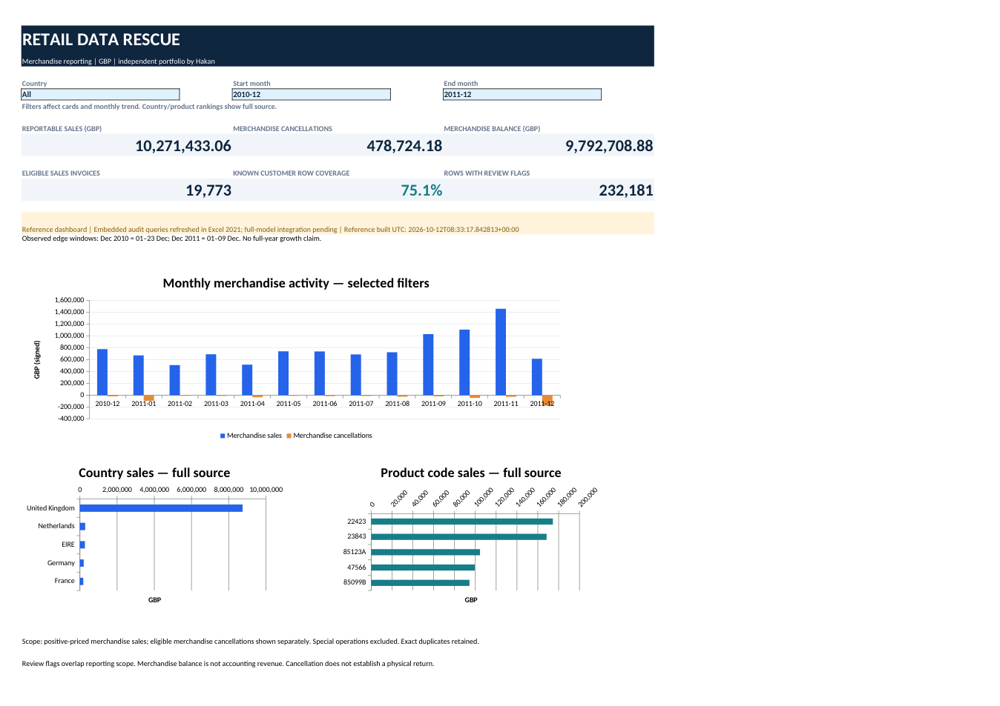
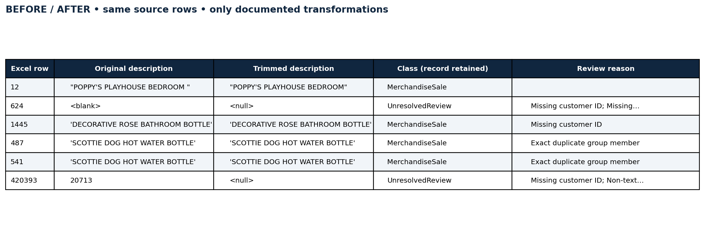

# Retail Data Rescue — Excel & Power Query

**Turning a messy retail export into traceable decisions and reconciled reporting.**

A portfolio case study by **Hakan** using 541,909 transaction lines from UCI Online Retail. The focus is data quality, justified treatment of exceptions, and evidence behind the numbers.

[Download the Excel workbook](https://raw.githubusercontent.com/hakankoksalcan/Retail-Data-Rescue-Excel-Power-Query/main/Retail_Data_Rescue.xlsx) · [Client handover](Client_Handover.pdf) · [Decision log](docs/KARAR_GUNLUGU_TR.md) · [Validation evidence](validation/README.md)



## The business question

A retailer sends an export containing sales, cancellations, fees, adjustments, missing customer IDs and repeated records. Which transactions belong in merchandise reporting, which need review, and can every source row and amount be accounted for?

This is a public-data portfolio project, not a client engagement. Python provides the independent reference model; Excel provides the interactive report and embedded Power Query audit queries.

## What this release does

- **Live Excel audit:** four embedded Power Query queries read the original XLSX, count source rows/columns, report missing values, and prepare identifier types while retaining their raw values. Source and missing-value results were refreshed and checked in Windows 11 / Excel 2021.
- **Reference dashboard:** Excel formulas and country/month selections operate on the supplied, reconciled reporting tables. The six filtered KPI results were checked in Excel 2021. Country/product rankings deliberately show the full source.
- **Full transformation source:** the classification, review register, reconciliation and reporting model is supplied as 20 M files in [`power_query/`](power_query/). Its syntax is validated; its end-to-end Excel execution and connection to the dashboard remain the next integration milestone.

Refreshing the four embedded audit queries does **not** regenerate the reference dashboard tables. The exact coverage and remaining Excel acceptance checks are documented in [the validation ledger](validation/README.md).

## Verified data quality findings

The source workbook was inspected directly; these are observed findings, not simulated defects.

| Finding | Count | Treatment |
|---|---:|---|
| Missing CustomerID | 135,080 rows | Keep otherwise eligible sales; restrict customer analysis to known IDs |
| Missing Description | 1,454 rows | Preserve and flag; investigate with price/quantity context |
| Exact duplicate groups | 4,879 groups | Retain in the main result; compare a separate first-record scenario |
| Additional exact duplicate occurrences | 5,268 rows | Quantify the effect instead of silently deleting |
| C-prefix cancellation records | 9,288 rows | Interpret as cancellations; physical returns are not established |
| Negative quantity without C | 1,336 rows | Review separately; do not automatically call every negative an error |
| Zero / negative prices | 2,515 / 2 rows | Separate by transaction context and explicit code rules |
| Codes with multiple raw text descriptions | 650 codes | Preserve variants; use product codes for ambiguous labels |
| Absolute line amount ≥ GBP 10,000 | 17 rows | Flag for review and retain source-row traceability |

All source dates are native Excel datetimes. No fictional date-format problem was introduced. See [the detailed source audit](docs/stage1-VERI_UYGUNLUK_DENETIMI.md) for examples and reproducible checks.

## Decisions that change the report

1. **A row is an invoice line.** The 541,909 rows contain 25,900 distinct invoice IDs; different products on one invoice are not duplicates.
2. **Review does not mean exclusion.** Review flags overlap. The 232,181-row register is the union of flagged records, not the sum of issue counts.
3. **Missing identity and missing sales are different.** A sale may remain reportable without a customer ID, while being ineligible for customer-level analysis.
4. **Operational lines have explicit rules.** Postage, fees, manual adjustments and vouchers are separated using the documented [code map](docs/code-rules.json). An unusual code alone is not enough to call it a service.
5. **Amounts preserve source precision.** Calculations use integer units of 1/10,000 GBP; the display uses two decimals. Raw fields and source-row IDs remain available.



## Reconciled reference results

| Measure | Result |
|---|---:|
| Reportable merchandise sales | GBP 10,271,433.063 |
| Merchandise cancellations, positive magnitude | GBP 478,724.180 |
| Signed merchandise balance | GBP 9,792,708.883 |
| Eligible sales invoice IDs | 19,773 |
| Known-customer sales row coverage | 75.10% |
| Rows with review flags | 232,181 |

The five exclusive classes account for every source row:

| Class | Rows | Signed amount, GBP |
|---|---:|---:|
| MerchandiseSale | 527,761 | 10,271,433.063 |
| MerchandiseCancellation | 8,704 | -478,724.180 |
| SpecialOperation | 2,946 | -44,960.949 |
| ZeroPriceAdjustment | 1,335 | 0.000 |
| UnresolvedReview | 1,163 | 0.000 |
| **Source total** | **541,909** | **9,747,747.934** |

The [reconciliation table](reference/Reconciliation.csv) explains the row and amount totals. The [bridge](reference/Bridge.csv) separates special operations to reach the merchandise balance. A count of invoices within different classes is not an additive distinct-invoice total.

Removing the 5,268 additional exact records in the alternative scenario reduces raw signed amount by **GBP 21,740.98** and merchandise balance by **GBP 21,390.72**. The published main result retains them. See [duplicate sensitivity](reference/DuplicateScenario.csv).

These measures are not accounting revenue or profit. The data does not establish payment, fulfilment, cancellation-to-original-invoice links or physical returns. The first and last months are partial observed windows; no full-year growth claim is made.

## Open and use

1. Download [`Retail_Data_Rescue.xlsx`](https://raw.githubusercontent.com/hakankoksalcan/Retail-Data-Rescue-Excel-Power-Query/main/Retail_Data_Rescue.xlsx) and open it in desktop Excel. The saved report can be explored without refreshing.
2. On **Dashboard**, choose Country (B5), Start month (F5), and End month (J5). Cards and the monthly chart use these filters; ranking charts retain full-source scope.
3. To refresh the audit, obtain the repository's unchanged [`raw/Online Retail.xlsx`](raw/Online%20Retail.xlsx), set **Settings!A6** to its absolute local path, and select **Data → Refresh All**.
4. **SourceCheck** should show 541,909 rows / 8 columns. **qMissingValues** should show 135,080 missing CustomerID and 1,454 missing Description.

The [Turkish setup guide](docs/KURULUM_YENILEME_TR.md) explains the embedded queries and the separate full-model integration steps. Keep raw data unchanged and use a separate workbook for integration testing.

## Reproduce the independent checks

Python 3.12 was used for reference generation. This is optional for viewing the Excel deliverable.

```bash
python -m venv .venv
# Activate the environment using your platform's command.
python -m pip install -r requirements-validation.txt
python scripts/build_reference.py
python scripts/build_reference_workbook.py
python scripts/test_refresh.py
python scripts/make_manifest.py
python scripts/validate_publication.py
```

`build_reference_workbook.py` produces a separate `reference/Reference_Workbook.xlsx`; it never replaces the Excel-authored main workbook. The full classified extract and TEST_ONLY workbook are generated locally and excluded from Git. The complete [review register](review/ReviewRecords.csv.gz) is included as compressed CSV.

For M syntax checks, use Node.js 22+:

```bash
npm ci --ignore-scripts
npm run validate:m
```

The reference checks cover source integrity, row/amount conservation, duplicate sensitivity, repeated reads and an isolated +GBP 7 test transaction. They are not substitutes for running the full M model in Excel. See [tests](tests/README.md) and [validation](validation/README.md).

## Repository map

| Location | Contents |
|---|---|
| `Retail_Data_Rescue.xlsx` | Excel-authored audit queries, reference tables, formula-driven dashboard |
| `power_query/embedded/` | Exact exports of the four embedded queries |
| `power_query/*.pq` | Full reporting model and output queries, supplied separately |
| `docs/` | Decision log, metric definitions, source audit, setup guide, portfolio summary |
| `reference/` | Reconciled comparison tables and model controls |
| `review/` | Complete overlapping review register, compressed CSV |
| `validation/` | Check results, scope and Excel evidence |
| `scripts/` | Reproducible reference generation and artifact validation |

## Source and licensing

Chen, D. (2015). *Online Retail* [Dataset]. UCI Machine Learning Repository. [DOI: 10.24432/C5BW33](https://doi.org/10.24432/C5BW33). Dataset license: **[CC BY 4.0](https://creativecommons.org/licenses/by/4.0/)**.

The original XLSX is preserved byte-for-byte. This project adds derived fields, classifications, review flags and reports. The synthetic transaction exists only in a clearly labelled, separately generated test workbook. Project code is MIT-licensed; dataset attribution and licensing are detailed in [SOURCE.md](SOURCE.md).
